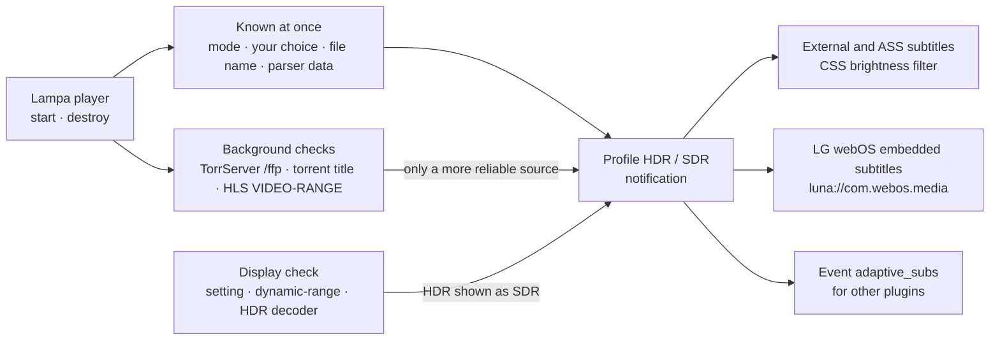

# Adaptive Subtitles for Lampa

[](https://github.com/emoorpheus/lampa-adaptive-subtitles/actions/workflows/ci.yml)
[](https://github.com/emoorpheus/lampa-adaptive-subtitles/releases)


A plugin for the [Lampa](https://github.com/yumata/lampa) media center that **dims subtitles in HDR, Dolby Vision and HLG video**,
so bright white text does not glare over dark scenes on OLED TVs. SDR video keeps Lampa's normal subtitles.

> **Version 1.1.0-beta.2 — a pre-release for testing.** New in the 1.1 betas: an **English interface** (the plugin follows the
> Lampa language) and, in beta.2, the **Display** setting — subtitles are no longer dimmed when HDR video is shown as SDR (an SDR
> screen, or a player that cannot play HDR) — and color keys that work on Android TV boxes. Beta.2 has been tested on an
> **Android TV box (Tanix TX9)**; the 1.1 betas have not been tested on an LG OLED TV yet. The stable version is
> [1.0.0](https://github.com/emoorpheus/lampa-adaptive-subtitles/releases/tag/v1.0.0), tested by the maintainer on an
> **LG OLED TV (webOS 25)** — see [Tested devices](#tested-devices). Samsung Tizen has not been reported yet.

[Russian version](README.ru.md)

## Contents

[Overview](#overview) · [Features](#features) · [Architecture](#architecture) · [Tested devices](#tested-devices) ·
[Installation](#installation) · [Settings](#settings) · [Language](#language) · [Privacy](#privacy) · [Known issues](#known-issues) ·
[Troubleshooting](#troubleshooting) · [For plugin developers](#for-plugin-developers) · [Development](#development)

## Overview

When playback starts, the plugin decides whether the video is HDR and switches the subtitle profile:

- **HDR / Dolby Vision / HLG** → subtitles are dimmed with a brightness filter (48 % by default), so colours and ASS styling are kept;
- **SDR** → subtitles stay exactly as Lampa draws them.
- **HDR video that is shown as SDR** (an SDR screen, or an Android TV box whose built-in player cannot play HDR) → subtitles are not
  dimmed either: dimmed text only looks right when the picture is really HDR ([Display](#settings)).

A short notification tells which profile was chosen and why (for example “Subtitles: HDR — dimmed, 48% (by name)”).
If the detection is wrong, a remote key switches the profile and remembers your choice for the torrent or the show.

## Features

- **Detection**, from the most to the least reliable: your manual choice → ffprobe data of the file (TorrServer `/ffp` or the
  torrent parser; distinguishes HDR10, Dolby Vision and HLG) → `VIDEO-RANGE` in the HLS master playlist → TorrServer torrent title →
  keywords in the file name (HDR, HDR10, HDR10+, DV, Dolby Vision, HLG; without false hits such as "DVDRip" or "HDRezka").
- **Display check** (setting **Display**, since 1.1.0-beta.2). In **Auto** the plugin does not dim if the browser reports a display
  without HDR (CSS `dynamic-range: standard`) or if the built-in player cannot decode HDR video (HEVC Main 10 and Dolby Vision,
  checked with `canPlayType` and `MediaSource.isTypeSupported`). On LG webOS and Samsung Tizen, Auto keeps the 1.0 behaviour: the video decides.
- **Dimming:** by brightness (colours preserved) or by recolouring to grey; one level for all HDR types or separate levels for HDR10, Dolby Vision and HLG.
- **All subtitle types Lampa shows in HTML:** external SRT/VTT, ASS (Lampa's simple renderer and JASSUB).
- **LG webOS embedded subtitles** (drawn by the TV, not by HTML): character opacity through `luna://com.webos.media`
  (`setSubtitleCharacterOpacity`) — the method Lampa itself uses; the opacity you chose in Lampa is kept in SDR and scaled down in HDR.
- **HDR/SDR key** in the player (a color key of your choice) with memory per torrent or per show, and **Forget manual HDR/SDR choices**.
  Also on Android TV boxes whose WebView reports color keys only by name (`ColorF0Red` … `ColorF3Blue`, key code 0).
- **SDR options:** colour and size of external subtitles (default: unchanged Lampa style).
- **One ffprobe request per file** shared with other plugins (`window.__lampa_ffp__`), for example with [Skip Intro](https://github.com/emoorpheus/lampa-skip-intro).
- **Event for other plugins** — Skip Intro uses it to dim its button in HDR.
- **Experimental (off by default, LG webOS only):** log what webOS reports about the video.
- **Interface in Russian or English**, following the Lampa language ([Language](#language)).
- **Old TVs:** plain ES5 + `Promise`, `filter` together with `-webkit-filter`, no dependencies, no third-party services.

## Architecture

The plugin is one file, `dist/adaptive_subs.js`, built from `src/NN_*.js`. It talks only to your TorrServer, to the stream
that is already playing and, on LG webOS, to the TV's media service.



1. **Quick decision.** On Lampa's player `start` event the plugin applies a profile at once from what is already known — the mode
   setting, your remembered choice, the file name and the torrent parser's ffprobe data — so the first subtitles are already right.
2. **Refinement.** Slower checks run in the background: ffprobe of the file through TorrServer `/ffp`, the TorrServer torrent title,
   `VIDEO-RANGE` in the HLS playlist. Each source has a priority; a weaker one never overrides a stronger one. The notification
   appears when the checks finish or after 1.5 s; a second one (“Subtitles updated: …”) only if a later check switches HDR ↔ SDR.
3. **Display.** If the HDR video will be shown as SDR (see the **Display** setting), the profile stays SDR and the notification says
   why, for example “Subtitles: SDR — normal (Dolby Vision by name; the player cannot play HDR)”. Your manual choice (**Mode**, the
   HDR/SDR key) is not overridden by this check.
4. **Styling.** Dimming is a CSS `brightness()` filter on Lampa's subtitle elements, including ASS (Lampa's simple renderer and JASSUB),
   so colours and karaoke effects stay. WebVTT cues drawn by the browser itself (`::cue`) cannot be filtered and are recoloured to grey of the same brightness.
5. **LG webOS.** Embedded subtitles are drawn by the TV's media pipeline, not by HTML. The plugin sets their character opacity through
   `luna://com.webos.media`, intercepting Lampa's own calls so that the opacity you chose in Lampa is kept as the base.
6. **Memory.** Manual HDR/SDR choices are stored per torrent hash or per show (at most 300), settings under `adaptive_subs_*`.

## Tested devices

Manual tests by the maintainer: **1.1.0-beta.2** on 2026-11-03 on the Tanix TX9 (a test plan run over `adb` and the WebView
developer tools) and **1.0.0** on 2026-11-01 on the LG TV (the tested build was the internal 4.0 with the same code — only the
version string, the header comment and two hint texts in the settings differ). **The 1.1 betas have not been tested on the LG TV yet.**

| Device | System and Lampa client | Result |
|---|---|---|
| LG OLED65M59LA | webOS 25, Lampa web app (served by Lampac) | **1.0.0:** subtitles dimmed in HDR and Dolby Vision video |
| Tanix TX9 | Android 11 (Android TV), Lampa Android app 1.12.4 (WebView 84), Lampa 3.4.4 | **1.1.0-beta.2:** the plugin reports `display: unknown`, `HDR decoder: no` — HDR is shown as SDR there; an SDR test video named `…2160p.WEB-DL.DV.HDR.mkv` keeps undimmed SRT and ASS subtitles with the notification “SDR — normal (Dolby Vision by name; the player cannot play HDR)”; the red key (sent with `adb` as `KEYCODE_PROG_RED`, the WebView reports `ColorF0Red`) switches HDR ↔ SDR; the **Display** setting is shown in the menu. **1.1.0-beta.1:** an online HLS stream with `VIDEO-RANGE=SDR` got SDR (by HLS stream); the same SDR video named DV was dimmed to 48 % and the color key did nothing — both fixed in beta.2 |

Reports from other devices are welcome — Samsung Tizen, other Android TV boxes, older webOS: [docs/tv-checklist.md](docs/tv-checklist.md).

## Installation

### Prerequisites

- **Lampa** with plugin support (Settings → Extensions). Developed against the Lampa 3.4.4 web build.
- An **HDR-capable TV** is the intended use. On an SDR screen **Display → Auto** usually turns dimming off by itself; if it does not,
  choose **Display → SDR only: do not dim**.
- Optional: **TorrServer** with the `/ffp` (ffprobe) endpoint — exact HDR type for torrents even when the file name says nothing.

### Step by step

1. In Lampa open **Settings → Extensions**.
2. Select **Add Plugin** and enter the plugin URL:

   ```text
   https://emoorpheus.github.io/lampa-adaptive-subtitles/adaptive_subs.js
   ```

   This address always serves the latest **stable** release (pre-releases are never published there). To try this beta,
   or to pin an exact version, use jsDelivr:

   ```text
   https://cdn.jsdelivr.net/gh/emoorpheus/lampa-adaptive-subtitles@v1.1.0-beta.2/dist/adaptive_subs.js
   ```

3. Restart Lampa (close the app completely and open it again).
4. Check that **Settings** now has the section **Adaptive Subtitles**.
5. Play an HDR video with subtitles (for example a file whose name contains `HDR`): a notification such as
   “Subtitles: HDR — dimmed, 48% (by name)” appears and the subtitles are dimmed. If the screen or the player shows HDR as SDR,
   the notification says “SDR — normal (…)” with the reason, and the subtitles stay as they are.
6. *(Optional)* In **Adaptive Subtitles → HDR/SDR key in the player** choose a color key to fix a wrong detection with one press.

### Self-hosting (Lampac or any web server)

Serve `dist/adaptive_subs.js` from your own server and add it by IP address — see [docs/self-hosting.md](docs/self-hosting.md).
Lampa adds its cache-busting `reset` parameter only to URLs **without** an IPv4 address, so a TV may keep an old copy after an update.
Put the version into the URL and change it with every update:

```text
http://<YOUR_SERVER_IP>:<PORT>/plugins/adaptive_subs.js?v=1.1.0-beta.2
```

> Do not use `raw.githubusercontent.com` links: GitHub serves them as `text/plain` with `X-Content-Type-Options: nosniff`,
> and browsers refuse to execute such files as scripts.

## Settings

**Settings → Adaptive Subtitles** (for the Russian names see [README.ru.md](README.ru.md)):

| Setting | Default | What it does |
|---|---|---|
| Mode | auto | auto / always HDR (dimmed) / always SDR (normal) |
| Display | auto | auto / HDR display: dim for HDR / SDR only: do not dim. **Auto:** no dimming if the browser reports a display without HDR or the built-in player cannot play HDR video; on LG webOS and Samsung Tizen the video decides |
| Exact check via TorrServer | on | ffprobe on TorrServer (`/ffp`): tells HDR10, Dolby Vision and HLG apart |
| By HLS stream (online) | on | Reads `VIDEO-RANGE` (SDR / HLG / PQ) from the m3u8 master playlist |
| HDR: method | dim | dim by brightness (colours kept) / recolour to grey |
| HDR: subtitle brightness | 48 % | 60 / 54 / 48 / 40 / 33 % |
| HDR10 / Dolby Vision / HLG: brightness | as the main level | Separate level when the HDR type is known |
| Dim ASS subtitles | on | ASS styling (colours, karaoke) is kept |
| HDR: built-in subtitle brightness (LG webOS) | 50 % | Share of the opacity chosen in Lampa, for subtitles drawn by the TV |
| SDR: external subtitle colour | unchanged | unchanged / white / soft white / warm yellow |
| External subtitle size | unchanged | five sizes from 3.2vh to 5.8vh, the same in SDR and HDR |
| Built-in subtitle size (LG webOS) | unchanged | 0 (smallest) … 4 (largest) |
| HDR/SDR key in the player | none | red / green / yellow / blue key; switches and remembers the profile |
| Notification on start | on | Which profile was chosen and why |

The webOS-only settings appear only on an LG TV. The experimental option **Respect the display HDR state** of 1.0 and 1.1.0-beta.1
is replaced by **Display**; its saved value is no longer used.

## Language

The plugin follows the Lampa interface language (**Settings → Interface → Interface language**): Russian when Lampa is in Russian,
English for every other language — settings, values and notifications. Lampa restarts after you change the language, and the
plugin's settings are built again in the new language. Without a saved language Lampa runs in Russian, and so does the plugin.

All interface strings are in one table, [`src/05_i18n.js`](src/05_i18n.js). To add a language, add its code to `I18N_LANGS` and a
translation to every string — see [CONTRIBUTING.md](CONTRIBUTING.md#translations). Log messages are always in English.

## Privacy

The plugin has no server of its own and uses no third-party APIs. It only sends:

- requests to **your TorrServer**: `/ffp/<hash>/<index>` (ffprobe) and `POST /torrents` (torrent title), with Lampa's TorrServer login if you set one;
- a request for the **HLS master playlist of the stream you are already playing** (to read `VIDEO-RANGE`);
- on LG webOS, calls to the TV's local media service (`luna://com.webos.media`).

Settings and your manual HDR/SDR choices (at most 300) are stored in Lampa's local storage.

**Loading the plugin file** (this is Lampa's behaviour, not the plugin's): if the plugin URL contains no IPv4 address
(GitHub Pages, jsDelivr), Lampa appends `logged`, `reset`, `origin` (the host Lampa is opened from, in Base64) and, if you are
signed in to your Lampa (CUB) account, `email` (the account e-mail in Base64) to it — function `addPluginParams` in the Lampa 3.4.4
web build. The server that hosts the file receives these parameters with the request. To avoid this, serve the file from your
own server by IP address ([docs/self-hosting.md](docs/self-hosting.md)).

## Known issues

- **Embedded subtitles on LG webOS** (inside an MKV, drawn by the TV) have not been checked separately on a real TV yet; the
  maintainer's test covered dimming in HDR and Dolby Vision video in general.
- **The 1.1 betas have not been tested on an LG OLED TV**, and Samsung Tizen has not been reported yet. On LG webOS and Tizen,
  **Display → Auto** does not change the 1.0 behaviour; this is covered by automated tests only.
- **Only Lampa's built-in player.** External players (for example an Android player app chosen in Lampa) draw their own subtitles;
  the plugin cannot change them. On the tested Tanix TX9, torrents were opened in such an external player.
- **Tanix TX9 (WebView 84):** the built-in player could not play an HEVC 10-bit HDR10 test file (`DEMUXER_ERROR_NO_SUPPORTED_STREAMS`),
  and the WebView reports no HEVC Main 10 or Dolby Vision decoder. Dimming on an Android TV box that does play HDR in Lampa's
  built-in player has not been reported yet.
- **Display → Auto cannot see everything.** If a TV or box converts HDR to SDR by itself while the browser still reports HDR support,
  Auto dims anyway — choose **Display → SDR only: do not dim**. If the browser reports a display without HDR although the picture is
  HDR, choose **Display → HDR display: dim for HDR**.
- **The version is not shown in the settings** — see [Troubleshooting](#troubleshooting). Self-hosted by IP: use `?v=<version>` after updates.

## Troubleshooting

- **HDR video, but the subtitles are not dimmed** (notification “Subtitles: SDR — normal (no HDR signs)”). The plugin found
  no HDR sign: the file name and the torrent title say nothing, and there is no ffprobe data (TorrServer without `/ffp`) or no
  `VIDEO-RANGE` in the stream. Press the HDR/SDR key — the choice is remembered for this torrent or show — or set
  **Mode → Always HDR (dimmed)**.
- **HDR video, the notification says “… display without HDR”, “… the player cannot play HDR” or “… display: SDR only”.**
  The plugin detected HDR but decided that the picture is shown as SDR (see **Display**). If your screen really shows HDR, set
  **Display → HDR display: dim for HDR**.
- **SDR video is dimmed** — usually its name contains an HDR word. Press the HDR/SDR key or set **Mode → Always SDR (normal)**.
  **Forget manual HDR/SDR choices** returns all titles to automatic detection.
- **The HDR/SDR key does nothing.** Check that the same color key is not assigned in another plugin (for example Skip Intro).
  A report with the device model helps ([docs/tv-checklist.md](docs/tv-checklist.md)).
- **LG webOS: embedded subtitles do not change.** They are drawn by the TV itself; the plugin only changes their opacity through
  the TV's media service. A report helps ([docs/tv-checklist.md](docs/tv-checklist.md)).
- **Which version is loaded?** The console prints `[AdaptiveSubs] v1.1.0-beta.2 initialized | display: … | HDR decoder: …`, and
  `window.AdaptiveSubs.version` returns the version. `display` is `high`, `standard` or `unknown` (the browser does not report it),
  `HDR decoder` is `yes`, `no` or `unknown`; `HDR shown as SDR (display | player | screen)` is added when Auto (or the setting) turns
  dimming off. On Android: `adb logcat | grep -F AdaptiveSubs`. For a self-hosted copy see
  [docs/self-hosting.md](docs/self-hosting.md#updating-and-cache).

## For plugin developers

- Lampa event `adaptive_subs` (via `Lampa.Listener`) and the DOM event `adaptive_subs:profile` on `window`, sent only when the state changes:
  `{ type: 'profile', profile: 'hdr' | 'sdr', kind: 'hdr' | 'hdr10' | 'dv' | 'hlg' | 'sdr', brightness: 0..1, source: '…' }`.
  Since 1.1.0-beta.2 an HDR video that is shown as SDR comes with `profile: 'sdr'`, its HDR `kind` and an extra field
  `screen: 'display' | 'player' | 'screen'` (the reason); without that field the event looks as before.
- `window.AdaptiveSubs`: `version`, `state` (current profile), `set('hdr' | 'sdr')`, `toggle()`, `detect(text)`, `kind(text)`,
  `screen()` (since 1.1.0-beta.2: `{ mode, tv, range, decoder, blocks }` — what the Display check sees).
- Shared ffprobe cache `window.__lampa_ffp__` (v1): `get(base, hash, index, authHeader, timeoutMs) → Promise<{ status, json }>`;
  an existing implementation is never replaced.

## Development

```sh
npm test         # build src/ -> dist/adaptive_subs.js (ES5 check) + unit tests; no npm install needed
npm run check    # scan for IP addresses, e-mails, tokens and personal paths before pushing
```

End-to-end tests, the release process and the rules for contributions: [CONTRIBUTING.md](CONTRIBUTING.md). Changes: [CHANGELOG.md](CHANGELOG.md).

The plugin was developed with the help of AI models: Opus 5.5 and Gemini 3.8 Flash. Instructions for AI coding assistants
(build, tests, rules, checks before publishing) are in [AGENTS.md](AGENTS.md); [CLAUDE.md](CLAUDE.md) points Claude Code to the same file.

## Credits

- [Lampa](https://github.com/yumata/lampa) by yumata — the webOS subtitle opacity call follows Lampa's own implementation.
- [acorn](https://github.com/acornjs/acorn) (MIT) — used only for build checks.

## Disclaimer

This is an independent, unofficial project. It is not affiliated with or endorsed by the authors of Lampa, Lampac, TorrServer, LG, Samsung or Google.

**Installing third-party plugins, enabling developer mode or sideloading apps on a TV or set-top box, and changing system settings
of your device are done entirely at your own risk.** On LG webOS this plugin calls the TV's media service to change subtitle opacity.
Such changes may violate the terms of your device or service, void the warranty or affect the stability of your device. The software is
provided "as is", without warranty of any kind (see [LICENSE](LICENSE)). The authors are not liable for any damage or data loss resulting from its use.

## License

[MIT](LICENSE)
