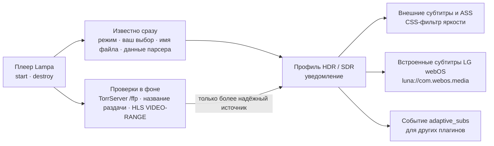

# Адаптивные субтитры для Lampa (Adaptive Subtitles)

[](https://github.com/emoorpheus/lampa-adaptive-subtitles/actions/workflows/ci.yml)
[](https://github.com/emoorpheus/lampa-adaptive-subtitles/releases)


Плагин для медиацентра [Lampa](https://github.com/yumata/lampa), который **приглушает субтитры в видео HDR, Dolby Vision и HLG**,
чтобы яркий белый текст не слепил на тёмных сценах на OLED-телевизорах. В SDR-видео субтитры остаются обычными, как в Lampa.

> **Версия 1.1.0-beta.1 — предварительный выпуск для проверки.** Новое: **английский интерфейс** (плагин следует языку Lampa).
> Эта бета проверена только автотестами. Стабильная версия —
> [1.0.0](https://github.com/emoorpheus/lampa-adaptive-subtitles/releases/tag/v1.0.0), проверена автором на
> **телевизоре LG OLED (webOS 25)** — см. [Проверенные устройства](#проверенные-устройства). С Samsung Tizen и Android TV отчётов пока нет.

[English version](README.md)

## Содержание

[Обзор](#обзор) · [Возможности](#возможности) · [Архитектура](#архитектура) · [Проверенные устройства](#проверенные-устройства) ·
[Установка](#установка) · [Настройки](#настройки) · [Язык](#язык) · [Приватность](#приватность) · [Известные проблемы](#известные-проблемы) ·
[Если что-то не работает](#если-что-то-не-работает) · [Для разработчиков плагинов](#для-разработчиков-плагинов) · [Разработка](#разработка)

## Обзор

При запуске видео плагин определяет, HDR ли это, и переключает профиль субтитров:

- **HDR / Dolby Vision / HLG** → субтитры затемняются фильтром яркости (по умолчанию 48 %), цвета и оформление ASS сохраняются;
- **SDR** → субтитры остаются ровно такими, какими их рисует Lampa.

Короткое уведомление сообщает, какой профиль выбран и почему (например, «Субтитры: HDR — затемнённые, 48% (по названию)»).
Если плагин ошибся, клавиша на пульте переключит профиль и запомнит выбор для раздачи или сериала.

## Возможности

- **Определение HDR**, от самого надёжного признака к менее надёжному: ваш ручной выбор → данные ffprobe о файле (TorrServer `/ffp`
  или парсер раздач; различает HDR10, Dolby Vision и HLG) → `VIDEO-RANGE` в мастер-плейлисте HLS → название раздачи в TorrServer →
  слова в имени файла (HDR, HDR10, HDR10+, DV, Dolby Vision, HLG; без ложных срабатываний на «DVDRip» или «HDRezka»).
- **Затемнение:** яркостью (цвета сохраняются) или перекраской в серый; один уровень для всех типов HDR или отдельные для HDR10, Dolby Vision и HLG.
- **Все субтитры, которые Lampa показывает в HTML:** внешние SRT/VTT, ASS (простой рендер Lampa и JASSUB).
- **Встроенные субтитры на LG webOS** (их рисует телевизор, а не HTML): прозрачность символов через `luna://com.webos.media`
  (`setSubtitleCharacterOpacity`) — тем же методом, что и сама Lampa; выбранная в Lampa прозрачность сохраняется в SDR и пропорционально уменьшается в HDR.
- **Клавиша HDR/SDR** в плеере (цветная кнопка на выбор) с запоминанием для раздачи или сериала и пункт «Забыть ручные выборы HDR/SDR».
- **Настройки SDR:** цвет и размер внешних субтитров (по умолчанию стиль Lampa не меняется).
- **Один запрос ffprobe на файл** вместе с другими плагинами (`window.__lampa_ffp__`), например с [«Пропуском заставок»](https://github.com/emoorpheus/lampa-skip-intro).
- **Событие для других плагинов** — «Пропуск заставок» по нему приглушает свою кнопку в HDR.
- **Эксперименты (по умолчанию выключены):** учитывать динамический диапазон экрана; записывать в журнал, что webOS сообщает о видео.
- **Интерфейс на русском или английском** — по языку Lampa ([Язык](#язык)).
- **Старые ТВ:** чистый ES5 + `Promise`, `filter` вместе с `-webkit-filter`, без зависимостей и сторонних сервисов.

## Архитектура

Плагин — один файл `dist/adaptive_subs.js`, собранный из `src/NN_*.js`. Он обращается только к вашему TorrServer, к уже
воспроизводимому потоку и на LG webOS — к медиасервису телевизора.



1. **Быстрое решение.** По событию плеера Lampa `start` плагин сразу применяет профиль по тому, что уже известно, — режиму в настройках,
   запомненному выбору, имени файла и данным ffprobe от парсера раздач, — поэтому первые же субтитры выглядят правильно.
2. **Уточнение.** Медленные проверки идут в фоне: ffprobe файла через TorrServer `/ffp`, название раздачи в TorrServer, `VIDEO-RANGE`
   в плейлисте HLS. У каждого источника свой приоритет; более слабый никогда не перебивает более сильный. Уведомление появляется,
   когда проверки закончились, или через 1,5 с; второе («Субтитры уточнены: …») — только если поздняя проверка сменила HDR ↔ SDR.
3. **Оформление.** Затемнение — CSS-фильтр `brightness()` на элементах субтитров Lampa, включая ASS (простой рендер Lampa и JASSUB),
   поэтому цвета и караоке-эффекты сохраняются. Субтитры WebVTT, которые рисует сам браузер (`::cue`), фильтровать нельзя — они перекрашиваются в серый той же яркости.
4. **LG webOS.** Встроенные субтитры рисует медиаконвейер телевизора, а не HTML. Плагин задаёт прозрачность символов через
   `luna://com.webos.media` и перехватывает собственные вызовы Lampa, чтобы основой оставалась прозрачность, выбранная вами в Lampa.
5. **Память.** Ручные выборы HDR/SDR хранятся по хешу раздачи или по сериалу (не больше 300), настройки — в ключах `adaptive_subs_*`.

## Проверенные устройства

Ручная проверка автором 2026-11-01, **версия 1.0.0**: проверялась внутренняя сборка 4.0 с тем же кодом — отличаются только строка
версии, комментарий в начале файла и две подсказки в настройках. **1.1.0-beta.1 на ТВ ещё не проверялась.**

| Устройство | Система и клиент Lampa | Результат |
|---|---|---|
| LG OLED65M59LA | webOS 25, веб-приложение Lampa (с сервера Lampac) | субтитры приглушаются в видео HDR и Dolby Vision |

Отчёты с других устройств очень помогут — Samsung Tizen, Android TV, старые версии webOS: [docs/tv-checklist.md](docs/tv-checklist.md).

## Установка

### Что нужно

- **Lampa** с поддержкой плагинов (Настройки → Расширения). Плагин разрабатывался для веб-сборки Lampa 3.4.4.
- **Телевизор с HDR** — основной сценарий. На SDR-экране выберите «Режим → Всегда SDR» (или попробуйте экспериментальную проверку экрана).
- По желанию: **TorrServer** с адресом `/ffp` (ffprobe) — точный тип HDR у торрентов, даже если в имени файла ничего нет.

### По шагам

1. В Lampa откройте **Настройки → Расширения**.
2. Выберите **«Добавить плагин»** и введите адрес:

   ```text
   https://emoorpheus.github.io/lampa-adaptive-subtitles/adaptive_subs.js
   ```

   По этому адресу всегда последний **стабильный** выпуск (предварительные туда не публикуются). Чтобы попробовать эту бету
   или закрепить точную версию, используйте jsDelivr:

   ```text
   https://cdn.jsdelivr.net/gh/emoorpheus/lampa-adaptive-subtitles@v1.1.0-beta.1/dist/adaptive_subs.js
   ```

3. Перезапустите Lampa (полностью закройте приложение и откройте снова).
4. Убедитесь, что в **Настройках** появился раздел **«Адаптивные субтитры»**.
5. Включите HDR-видео с субтитрами (например, файл, в имени которого есть `HDR`): появится уведомление вроде
   «Субтитры: HDR — затемнённые, 48% (по названию)», и субтитры станут темнее.
6. *(По желанию)* В **Адаптивные субтитры → «Клавиша HDR/SDR в плеере»** выберите цветную кнопку, чтобы исправлять ошибку одним нажатием.

### Свой сервер (Lampac или любой веб-сервер)

Раздавайте `dist/adaptive_subs.js` со своего сервера и подключайте по IP-адресу — см. [docs/self-hosting.md](docs/self-hosting.md).
Параметр против кэша `reset` Lampa добавляет только к адресам **без** IPv4, поэтому после обновления ТВ может держать старую копию.
Укажите версию в адресе и меняйте её при каждом обновлении:

```text
http://<YOUR_SERVER_IP>:<PORT>/plugins/adaptive_subs.js?v=1.1.0-beta.1
```

> Не используйте ссылки `raw.githubusercontent.com`: GitHub отдаёт их как `text/plain` с `X-Content-Type-Options: nosniff`,
> и браузеры отказываются выполнять такие файлы как скрипты.

## Настройки

**Настройки → Адаптивные субтитры** (в английском интерфейсе — Settings → Adaptive Subtitles):

| Настройка | По умолчанию | Что делает |
|---|---|---|
| «Режим» | авто | авто / всегда HDR (приглушённые) / всегда SDR (обычные) |
| «Точно по файлу через TorrServer» | вкл. | ffprobe на TorrServer (`/ffp`): различает HDR10, Dolby Vision и HLG |
| «По потоку HLS (онлайн)» | вкл. | Читает `VIDEO-RANGE` (SDR / HLG / PQ) из мастер-плейлиста m3u8 |
| «Учитывать HDR экрана (эксперимент)» | выкл. | Не затемнять, если браузер сообщает, что экран сейчас в SDR (`dynamic-range`) |
| «HDR: способ» | затемнять | затемнять яркостью (цвета сохраняются) / перекрашивать в серый |
| «HDR: яркость субтитров» | 48 % | 60 / 54 / 48 / 40 / 33 % |
| «HDR10 / Dolby Vision / HLG: яркость» | как основной уровень | Отдельный уровень, если тип HDR известен |
| «Затемнять субтитры ASS» | вкл. | Оформление ASS (цвета, караоке) сохраняется |
| «HDR: яркость встроенных субтитров (LG webOS)» | 50 % | Доля от прозрачности, выбранной в Lampa, для субтитров, которые рисует телевизор |
| «SDR: цвет внешних субтитров» | не менять | не менять / белый / мягкий белый / тёплый жёлтый |
| «Размер внешних субтитров» | не менять | пять размеров от 3.2vh до 5.8vh, одинаково в SDR и HDR |
| «Размер встроенных субтитров (LG webOS)» | не менять | 0 (самый маленький) … 4 (самый большой) |
| «Клавиша HDR/SDR в плеере» | нет | красная / зелёная / жёлтая / синяя; переключает и запоминает профиль |
| «Уведомление при старте» | вкл. | Какой профиль включился и почему |

Настройки только для webOS видны только на телевизоре LG.

## Язык

Плагин следует языку интерфейса Lampa (**Настройки → Интерфейс → Язык интерфейса**): русский, если Lampa на русском, английский —
для всех остальных языков: настройки, значения и уведомления. После смены языка Lampa перезапускается, и раздел настроек плагина
строится заново на новом языке. Если язык не сохранён, Lampa работает на русском — и плагин тоже.

Все строки интерфейса — в одной таблице [`src/05_i18n.js`](src/05_i18n.js). Чтобы добавить язык, добавьте его код в `I18N_LANGS`
и перевод каждой строки — см. [CONTRIBUTING.md](CONTRIBUTING.md#translations). Сообщения журнала всегда на английском.

## Приватность

У плагина нет своего сервера, и он не использует сторонние API. Он отправляет только:

- запросы к **вашему TorrServer**: `/ffp/<hash>/<index>` (ffprobe) и `POST /torrents` (название раздачи), с логином TorrServer из Lampa, если он задан;
- запрос **мастер-плейлиста HLS того потока, который вы уже смотрите** (чтобы прочитать `VIDEO-RANGE`);
- на LG webOS — вызовы локального медиасервиса телевизора (`luna://com.webos.media`).

Настройки и ваши ручные выборы HDR/SDR (не больше 300) хранятся в локальном хранилище Lampa.

**Загрузка файла плагина** (это поведение Lampa, а не плагина): если в адресе плагина нет IPv4-адреса (GitHub Pages, jsDelivr),
Lampa добавляет к нему `logged`, `reset`, `origin` (адрес, с которого открыта Lampa, в Base64) и, если вы вошли в аккаунт
Lampa (CUB), `email` (почта аккаунта в Base64) — функция `addPluginParams` в веб-сборке Lampa 3.4.4. Сервер, на котором лежит файл,
получает эти параметры вместе с запросом. Чтобы этого избежать, раздавайте файл со своего сервера по IP-адресу ([docs/self-hosting.md](docs/self-hosting.md)).

## Известные проблемы

- **Встроенные субтитры на LG webOS** (внутри MKV, их рисует телевизор) отдельно на настоящем ТВ пока не проверялись; проверка
  автора касалась приглушения в видео HDR и Dolby Vision в целом.
- **Android TV и Samsung Tizen** — отчётов пока нет.
- **Версия не показывается в настройках** — см. [Если что-то не работает](#если-что-то-не-работает). Свой сервер по IP: после обновления используйте `?v=<версия>`.

## Если что-то не работает

- **HDR-видео, а субтитры не затемнены** (уведомление «Субтитры: SDR — обычные (признаков HDR нет)»). Плагин не нашёл признаков HDR:
  в имени файла и названии раздачи ничего нет, а данных ffprobe нет (TorrServer без `/ffp`) или в потоке нет `VIDEO-RANGE`.
  Нажмите клавишу HDR/SDR — выбор запомнится для раздачи или сериала — или выберите «Режим → Всегда HDR».
  Если в уведомлении написано «экран без HDR», выключите «Учитывать HDR экрана (эксперимент)».
- **SDR-видео затемнено** — обычно в его имени есть слово HDR. Нажмите клавишу HDR/SDR или выберите «Режим → Всегда SDR».
  «Забыть ручные выборы HDR/SDR» возвращает все тайтлы к автоматическому определению.
- **LG webOS: встроенные субтитры не меняются.** Их рисует сам телевизор; плагин только меняет их прозрачность через медиасервис
  телевизора. Отчёт поможет ([docs/tv-checklist.md](docs/tv-checklist.md)).
- **Какая версия загружена?** В консоли есть строка `AdaptiveSubs v1.1.0-beta.1 initialized`, а `window.AdaptiveSubs.version` возвращает версию.
  На Android: `adb logcat | grep -F AdaptiveSubs`. Для своего сервера см. [docs/self-hosting.md](docs/self-hosting.md#updating-and-cache).

## Для разработчиков плагинов

- Событие Lampa `adaptive_subs` (через `Lampa.Listener`) и DOM-событие `adaptive_subs:profile` на `window`, только при смене состояния:
  `{ type: 'profile', profile: 'hdr' | 'sdr', kind: 'hdr' | 'hdr10' | 'dv' | 'hlg' | 'sdr', brightness: 0..1, source: '…' }`.
- `window.AdaptiveSubs`: `version`, `state` (текущий профиль), `set('hdr' | 'sdr')`, `toggle()`, `detect(text)`, `kind(text)`.
- Общий кэш ffprobe `window.__lampa_ffp__` (v1): `get(base, hash, index, authHeader, timeoutMs) → Promise<{ status, json }>`;
  уже существующая реализация не заменяется.

## Разработка

```sh
npm test         # сборка src/ -> dist/adaptive_subs.js (проверка ES5) + модульные тесты; npm install не нужен
npm run check    # поиск IP-адресов, почты, токенов и личных путей перед публикацией
```

Сценарии E2E, порядок выпуска и правила для участников: [CONTRIBUTING.md](CONTRIBUTING.md). Изменения: [CHANGELOG.md](CHANGELOG.md).

## Благодарности

- [Lampa](https://github.com/yumata/lampa) от yumata — вызов прозрачности субтитров webOS повторяет реализацию самой Lampa.
- [acorn](https://github.com/acornjs/acorn) (MIT) — только для проверок при сборке.

## Отказ от ответственности

Это независимый неофициальный проект. Он не связан с авторами Lampa, Lampac, TorrServer, LG, Samsung или Google и не одобрен ими.

**Установка сторонних плагинов, включение режима разработчика или установка приложений в обход магазина на ТВ или приставке,
а также изменение системных настроек устройства — полностью на ваш риск.** На LG webOS плагин обращается к медиасервису телевизора,
чтобы менять прозрачность субтитров. Такие изменения могут нарушать условия использования устройства или сервиса, лишить гарантии
или повлиять на стабильность устройства. Программа предоставляется «как есть», без каких-либо гарантий (см. [LICENSE](LICENSE)).
Авторы не несут ответственности за ущерб или потерю данных, возникшие при её использовании.

## Лицензия

[MIT](LICENSE)
